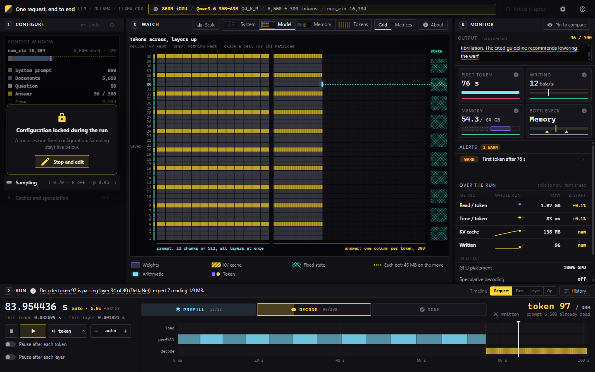

<p align="center">
  <a href="https://infraphysics.net/lab/projects/llm-inference-console"></a>
</p>

<h1 align="center"> tokenwalk</h1>

<p align="center">
  Watch one LLM request walk through a local machine.<br>
  Where every byte lives, what each layer reads, how the KV cache fills, and why the first word takes a minute.
</p>

<p align="center">
  <a href="LICENSE"></a>
  
  
</p>

<p align="center">
  <b>A project of <a href="https://infraphysics.net">InfraPhysics</a>.</b>
  Try it live at <a href="https://infraphysics.net/playgrounds/7148293/simulator"><b>infraphysics.net/playgrounds/7148293/simulator</b></a><br>
  How it is built: <a href="https://infraphysics.net/lab/projects/llm-inference-console">the project page</a> ·
  the ideas, one at a time: <a href="https://infraphysics.net/blog/bits2bricks/transformers-and-local-inference-from-zero">the article</a>
</p>

---

You pick a machine, a model and a prompt; tokenwalk plays the request pass by pass. Connect it to your own Ollama or llama.cpp and it runs the same request for real, next to its estimate (see [Real machine mode](#real-machine-mode)).



## Run it

```bash
npm i
npm run dev        # http://localhost:5173
npm run build      # dist/index.html and dist/tokenwalk.html, one self-contained file each
npm test           # unit tests of the cost model, then browser checks (needs Chrome; set CHROME if it is not in the default place)
```

There is no framework and nothing at runtime: one HTML page, a canvas, and about 3,200 lines of script. The source is split into ordered parts in `src/parts/` that share one scope, the way the original single file did; `vite.config.ts` joins them, strips the types and inlines everything into the page.

## What is real and what is a model

Nothing here runs a neural network. tokenwalk is a cost model, and it is honest about which of its numbers are which:

- **Calibrated.** The laptop preset (a ThinkPad with a Radeon 860M iGPU, 64 GB of shared LPDDR5X, Qwen3.6 35B-A3B at Q4_K_M under Ollama) is fitted to measured runs: about 76 s to the first token for a 6,500-token prompt, then about 12 tokens a second without MTP drafting (see [Real machine mode](#live-mode) for what drafting changes).
- **Read from the files.** Layer counts, heads, experts and which layers keep KV come from the GGUF headers.
- **Estimated.** Every other machine is the same formulas with that machine's bandwidth and compute; the console marks them as estimates.
- **Illustrative.** The answer text, the logits and the values inside a row of weights are made up. Their sizes are not.

## The cost model in four lines

```
KV per token      = 2 × attention layers × KV heads × head size × bytes per number          (20,480 B for Qwen3.6 at f16)
decode, s/token   = (weights read per token + KV so far) / effective bandwidth + per-layer overhead
prefill, s/chunk  = max(weights read for the chunk / bandwidth, 2 × active params × 512 / FLOPS) + attention + overhead
experts woken     = E × (1 − (1 − k/E)^n)     for n tokens in a pass, each picking k of E experts
```

Writing is bound by memory: every token re-reads all its active weights for about two operations per byte. Reading the prompt is bound by arithmetic: one read of the weights serves a whole chunk of 512 tokens. Almost everything else in the console is those two facts seen from different angles.

## Layout

```
index.html            the markup
src/styles.css        the look
src/parts/00-*.ts …   the script, in order: data and formulas, language, state, the request computed,
                      sampling, playback, history, drawing kit, entities, the four views, zoom,
                      explainers, alerts, timeline, monitor, run, configure, loadout, glossary, wiring,
                      the real-server connection and the Simulated / Real machine mode
src/globals.d.ts      types shared by the parts
tests/unit/           the cost model in node, no browser
tests/browser/        a small CDP client and the regression checks (overflow, zoom, fit, sampling, links)
tools/                split-legacy.mjs (the port from the original single file), single-file.mjs
```

The data, language, state, cost model, sampling, playback, history, drawing and entity parts are type-checked; the DOM-heavy UI parts still carry `@ts-nocheck` and are next to type.

## Real machine mode

tokenwalk can send a request to a real server on your machine and put the measured numbers next to its estimate. It is optional: without a server everything is simulated.

### 1. Start a server the browser is allowed to reach

A browser page can only talk to a local server that allows the page's **origin** (the scheme, host and port it was loaded from). What you need depends on how you opened tokenwalk:

| How you opened tokenwalk | Its origin | Ollama, out of the box | What to do |
|---|---|---|---|
| `npm run dev` | `http://localhost:5173` | allowed | nothing |
| `npm run preview` | `http://localhost:4173` | allowed | nothing |
| `dist/tokenwalk.html` opened from disk | `null` | refused | serve it (`npm run preview`), or allow every origin (below) |
| [infraphysics.net/…/simulator](https://infraphysics.net/playgrounds/7148293/simulator) | `https://infraphysics.net` | refused | allow it (below) |

(Checked against Ollama 0.40.7: any `localhost` or `127.0.0.1` port is accepted; `null` and other sites get 403.)

**Ollama.** Set `OLLAMA_ORIGINS` to the origin and restart Ollama. Several origins can be comma-separated; `*` allows any page, which also lets any website you visit talk to your Ollama, so prefer the exact origin.

Windows (PowerShell or cmd), then quit Ollama from the tray icon and open it again:

```bat
setx OLLAMA_ORIGINS "https://infraphysics.net"
```

macOS (the app), then quit and reopen Ollama:

```bash
launchctl setenv OLLAMA_ORIGINS "https://infraphysics.net"
```

Linux (systemd service):

```bash
sudo systemctl edit ollama.service
# add under [Service]:
#   Environment="OLLAMA_ORIGINS=https://infraphysics.net"
sudo systemctl restart ollama
```

Or for one session in a terminal: `OLLAMA_ORIGINS=https://infraphysics.net ollama serve`.

**llama.cpp.** `llama-server` allows every origin by default (`--cors-origins *`). Give it the port tokenwalk expects, since recent builds default to 9931:

```bash
llama-server -m model.gguf --host 127.0.0.1 --port 8080
# to restrict it: --cors-origins https://infraphysics.net   (or: --cors-origins localhost)
```

### 2. Check it before opening the page

```bash
# 204 means the origin is allowed; 403 means it is not (set OLLAMA_ORIGINS and restart)
curl -s -o /dev/null -w "%{http_code}\n" -X OPTIONS http://localhost:11434/api/tags -H "Origin: https://infraphysics.net" -H "Access-Control-Request-Method: GET"
curl http://localhost:11434/api/version        # Ollama answers {"version": ...}
curl http://localhost:8080/props               # llama-server answers with its settings
```

### 3. Use it

The top bar has a switch, left of the setup line: **Simulated | Real machine**. The console is in one mode at a time.

- **Simulated** (yellow): every number comes from the cost model, and the request plays at any speed, pauses, steps and jumps.
- **Real machine** (cyan, a laptop with a soft glow; its tooltip names the server, the address and the model): the console is a window on the server. The setup line reads *this machine (real) / server model and quantization / prompt + max tokens / num_ctx*, which is exactly what is sent.

Switching to Real machine with no server connected opens the connect window, with the address (`http://localhost:11434` for Ollama, `http://localhost:8080` for llama-server), **Connect**, and the setup steps with copy buttons. It names every state: not connected, connecting, blocked by CORS (with the fix), nothing answered. When the server answers the console enters Real; if it fails, or you close the window, the simulation stays as it was. Once connected the window says **Connected**, with the model picker, **Change server** and **Disconnect**; none of them can be used while a request runs, and they say why.

In Real machine:

- **Setup** shows only what applies to the server. *Request to the server*: the model (the server's list), the prompt (short question, a long history or your own text), max tokens, and MTP drafts when it is Ollama. *Engine*: num_ctx and keep_alive. *Sampling*: temperature, top-k, top-p, seed. *This machine* shows the server version and address, and **Estimate as**, the machine preset the estimate is drawn on. The simulation-only sections (request token sliders, KV type, KV to disk, cold start, a separate draft model, scenarios) are hidden.
- **Request** (the Playback zone) has **Send** and **Stop**. Speed, jumps, steps, pause-after and the timeline scale are greyed: a real server cannot be slowed, paused or stepped. The timeline draws the run as it arrives (load, prefill, decode with a tick for each token) on a real-time axis and keeps it as the record of that run; the clock shows its wall time.
- **Observatory:** Tokens shows the real answer with each token's arrival time; click one to see what the server chose it from (Ollama `logprobs`, llama-server `n_probs`), when the server sends that. System, Model and Memory draw the cost model's estimate for the server's model on the Estimate as machine, tagged **estimate**.
- **Monitor:** *Estimate vs measured* comes first: load, time to first token, prefill and decode speed, total, with the ratio. **Calibrate the estimate to this machine** fits the preset's effective bandwidth (from decode, with MTP drafting taken out first) and compute (from prefill, if the prompt has 256 tokens or more); kept per machine in your browser, with Reset.

Switching back to Simulated restores the simulation exactly; the two keep separate settings and both are saved. If a real request is running, it asks first (*Keep running* is the default). While in Real the page checks the server every 10 s; if it is gone a banner says **Lost the server at …** with **Retry** and **Back to simulation**. On the next visit the console resumes Real only when the server answers within about 1.5 s; otherwise it starts in the simulation, with no connected look.

What is sent: num_ctx, temperature, top_p, top_k, seed, keep_alive and MTP drafting (`draft_num_predict`) for Ollama; the sampling settings and `cache_prompt` for llama-server. The connect window lists the exact options of each request, and the settings that are sent are marked *sent* in Setup.

### MTP, and why the laptop is not simply "12 tokens a second"

Both Qwen models carry one extra *next-n* block (`nextn_predict_layers: 1` in the GGUF) trained to guess the tokens after the next one, and Ollama uses it by default as a built-in draft (`draft_num_predict 2`): the block guesses two tokens, one pass of the full model checks them, and the ones that match are kept. Measured on the laptop (qwen3.6:35b-a3b, Ollama 0.40.7, 96-token answers):

| | tok/s | vs. no drafting |
|---|---|---|
| Drafting off (`draft_num_predict 0`) | 13.2 | |
| Drafting on, temperature 0, long prompt | 15.6 | ×1.18 |
| Drafting on, temperature 0.7 | 11.5 and 10.6 | ×0.87, ×0.80 |

A guess costs a read of one block plus the output head (0.35 GB, about a fifth of a full pass), so drafting pays only when most guesses survive: it helps greedy, predictable text and costs time when sampling freely. tokenwalk models it as speculative rounds with an acceptance rate fitted to these runs (0.55 at temperature 0, 0.25 at 0.7): for the article's request, 12.1 tok/s without drafting, 10.2 with it at temperature 0.7, 14.4 at 0. Switch it under *Caches and speculation*. A side effect worth knowing: with drafting on, Ollama 0.40.7 returns `logprobs` for only a few tokens (2 of 16 in a test, 16 of 16 with drafting off).

### When it does not connect

- **"Blocked by CORS"**: the server is running but refuses this page's origin. Set `OLLAMA_ORIGINS` as above and restart Ollama completely (the tray app, not just a terminal).
- **"Nothing answered"**: nothing answers at that address. Start Ollama (`ollama serve`) or llama-server, and check the port.
- **The browser asks about local network access**: allow it; a public page reaching `localhost` needs that permission in recent Chrome.
- **The first run is slow**: the server loads the model from disk first (Load in the table); the next run is warm until keep_alive runs out.

### What stays simulated

Everything inside a pass: which layer, which matrix, the KV cache filling, the sampling chain of a simulated token. A server reports totals and the tokens it sent, not what happens per layer; the real run gives the console real totals to hold the estimate against.

Tests: `npm test` runs the cost-model, MTP and live-parsing unit tests (on responses recorded from Ollama, in `tests/fixtures/`) and the browser checks, which include live mode against a mocked server. `npm run test:live` runs one real request against a local Ollama and skips when none answers.

## Roadmap

Typing the UI parts and turning the ordered parts into ES modules.

## License

MIT
